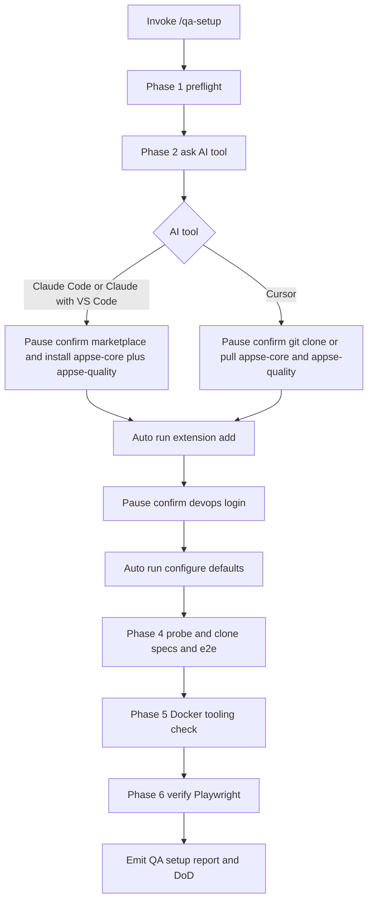

# Initialize QA Environment

Use `/qa-setup` to bring a quality engineer from a fresh machine to a fully working appse ai QA environment without manually walking scattered runbooks. The skill follows a **hybrid execution model**:

- **Auto-runs** idempotent and read-only commands (version checks, `az extension add`, `az devops configure --defaults`, `az devops configure --list`, file existence checks, Docker tooling checks).
- **Pauses for explicit confirmation** before any interactive or stateful command (`az devops login`, `git clone`, plugin install, IDE restart).

This skill does **not** set up the platform monorepo (`arise`). For local platform under test, Docker Compose, and monorepo builds, use `/initialize-pe-env` and `/docker`.

## When to Use This Skill

Use this skill when:

- A quality engineer has just joined the team or has a freshly imaged machine.
- The engineer moves to a new workstation and needs the same setup.
- Any `qa-*` skill fails with environment errors (missing CLI, wrong AzDO defaults, missing repo, Docker CLI unavailable, Playwright missing).
- A plugin or marketplace upgrade requires re-verification.

Do not use this skill for:

- Installing Git, Docker Desktop, Node.js, Claude Code, Cursor, or VS Code themselves — these are prerequisites.
- Generating Personal Access Tokens — the engineer creates credentials via the Azure DevOps web UI.
- Production deployment — use the DevOps playbook and `ops-*` skills instead.
- Cloning, building, or running the `arise` platform monorepo — use `/initialize-pe-env` instead.
- Starting the full local Docker stack or verifying `http://localhost:3000/` — use `/initialize-pe-env` and `/docker` when a local platform under test is required.

## Related Skills and References

- Quality Engineering Playbook: `handbook/playbooks/quality-engineering/index.md` in `arise-specs`.
- Install plugin (canonical): `handbook/playbooks/install-plugin.md`.
- Plugin install convention: `conventions/plugin-install.md` in appse-core.
- Azure DevOps config: `handbook/azdo-config.md` (read after `arise-specs` is available).
- Role workspace convention: `conventions/workspace.md` in appse-core.
- Test push to AzDO: `/qa-push` (uses `mcp.json` from appse-core when configured in the IDE).

## Required Inputs

The skill asks for these only if missing:

| Input | Required | Default | Description |
|-------|----------|---------|-------------|
| IDE choice | Yes | — | `Cursor` / `Claude Code` / `Claude with VS Code`. Asked upfront. |
| Workspace root | Yes | `%USERPROFILE%\repos\arise-workspace` | Multi-root workspace — **must** include `arise-specs` and `arise-e2e` only. |
| Specs clone target | Yes | `%USERPROFILE%\repos\arise-workspace\arise-specs` | Handbook, specs, test plans and cases. |
| E2E clone target | Yes | `%USERPROFILE%\repos\arise-workspace\arise-e2e` | Playwright automation — required for `/qa-e2e`. |
| Pull existing clone | Conditional | `yes` | Asked only if a target directory already contains a clone. |

Constants the skill uses (do not ask unless overrides above):

| Constant | Value |
|----------|-------|
| Azure DevOps organization | `https://dev.azure.com/insyncworld` |
| Azure DevOps project | `APPSeCONNECT-Reimagine` |
| Specs repo URL | `https://insyncworld@dev.azure.com/insyncworld/APPSeCONNECT-Reimagine/_git/arise-specs` |
| E2E repo URL | `https://insyncworld@dev.azure.com/insyncworld/APPSeCONNECT-Reimagine/_git/arise-e2e` |
| Plugin marketplace (Claude Code) | `appseconnect/appse-marketplace` |
| Marketplace path (Cursor) | `%USERPROFILE%\.cursor\plugins\local\appse-marketplace` |
| Marketplace repo URL | `https://github.com/appseconnect/appse-marketplace.git` |
| Role plugin name | `appse-quality` |
| Workspace file | `%USERPROFILE%\repos\arise-workspace\qa-workspace.code-workspace` |
| Setup report path | `%USERPROFILE%\repos\arise-workspace\setup\qa-env-{YYYY-MM-DD}.md` |

## Why the workspace matters

QA agent skills reference:

- **`arise-specs/handbook/`** — eng-specs, test plans, test cases, QA reviews (`/qa-plan`, `/qa-cases`, `/qa-review`, `/qa-push`)
- **`arise-e2e/`** — Playwright automation (`/qa-e2e`)

**Both repositories must be open in the same IDE workspace** — otherwise skills cannot resolve handbook paths or E2E locations.

Test execution environments (shared QA, staging, or local platform) come from the test plan or PE/DevOps setup — not from cloning `arise` in this skill.

## Workflow

The skill executes six phases in order. After each phase it prints a status line. If any auto-run command fails or any pause is declined, the skill halts and surfaces the gap.

### Phase 1 — Pre-flight checks (auto-run, read-only)

Verify required tools are installed. Stop with a remediation message if any are missing.

| Check | Command | Failure remediation |
|-------|---------|---------------------|
| Git present | `git --version` | Install Git for the platform |
| Azure CLI present | `az --version` | `winget install Microsoft.AzureCLI` (Windows) / `brew install azure-cli` (macOS) |
| Node.js present (18+) | `node --version` | `winget install OpenJS.NodeJS.LTS` (Windows) / `brew install node` (macOS) |
| Docker present | `docker --version` | Install Docker Desktop |
| Claude Code CLI (if IDE = Claude Code) | `claude --version` | Install Claude Code |
| VS Code (if IDE = Claude with VS Code) | `code --version` | Install VS Code |
| Cursor CLI (if IDE = Cursor) | `cursor --version` | Install Cursor |

### Phase 2 — AI tool selection and plugin install

1. **Ask which tool they are using.** Never guess:

   > "Which app are you working in? The install steps are different for each one.
   >
   > - **Cursor**
   > - **Claude Code** (the command line)
   > - **Claude with VS Code**"

2. **Branch by choice** — read `appse-marketplace/skills/references/ai-tool-plugin-install.md`:

   **Claude Code** or **Claude with VS Code** — pause for confirmation, then run:

   ```text
   /plugin marketplace add appseconnect/appse-marketplace
   /plugin install appse-core@appse
   /plugin install appse-quality@appse
   ```

   Verify with `/plugin list` — confirm **`appse-core`** and **`appse-quality`** are listed.

   **Cursor** — if **`/qa-setup`** was already run, skip to Phase 3.

   Otherwise follow **Phases 1–4** in `marketplace-plugin-install.md` for role plugin **`appse-quality`** (git clone to `%USERPROFILE%\.cursor\plugins\local\` — no symlinks).

   Remind the engineer to **restart Cursor** (`Developer: Reload Window`) after a fresh plugin clone, then re-run **`/qa-setup`** or **`/qa-setup`**.

3. **Optional — Azure DevOps MCP** (pause for confirmation): point at `mcp.json` in the **appse-core** plugin clone. Not required for CLI-only AzDO workflows.

### Phase 3 — Azure DevOps setup (mixed)

After `arise-specs` is available (Phase 4), re-read `handbook/azdo-config.md` for sprint/team overrides. For Phase 3 defaults, use the organization and project constants above.

1. **Auto-run** (idempotent):

   ```powershell
   az extension add --name azure-devops
   ```

2. **Pause** for confirmation, then run (interactive PAT prompt):

   ```powershell
   az devops login --organization https://dev.azure.com/insyncworld
   ```

3. **Auto-run**:

   ```powershell
   az devops configure --defaults organization=https://dev.azure.com/insyncworld project=APPSeCONNECT-Reimagine
   ```

4. **Auto-verify** (read-only):

   ```powershell
   az devops configure --list
   ```

   Confirm the listed org is `https://dev.azure.com/insyncworld` and project is `APPSeCONNECT-Reimagine`.

### Phase 4 — Workspace and repository clones (pause)

1. **Create the workspace root** (pause for confirmation if the folder does not exist):

   ```powershell
   New-Item -ItemType Directory -Force -Path "$env:USERPROFILE\repos\arise-workspace"
   New-Item -ItemType Directory -Force -Path "$env:USERPROFILE\repos\arise-workspace\setup"
   ```

2. For each repository (`arise-specs`, `arise-e2e`):

   a. **Ask** for the target directory (defaults under `arise-workspace` above). If the engineer already has clones at `%USERPROFILE%\repos\arise-specs` or `%USERPROFILE%\repos\arise-e2e`, offer to reference those paths in the workspace file instead of re-cloning — but **both repos must appear as workspace roots**. Do not add `%USERPROFILE%\repos\arise` or any `arise` platform monorepo path to the workspace.

   b. **Probe** the target:

   | State | Action |
   |-------|--------|
   | Empty or non-existent | Pause for confirmation, then `git clone <repo-url> <target>` |
   | Existing clone, working tree clean | Ask whether to pull latest. If yes, run `git -C <target> pull origin main` |
   | Existing clone, working tree dirty | Stop. Surface `git status` and instruct the engineer to commit, stash, or clean before re-running |
   | Existing non-empty directory that is not the expected repo | Stop. Ask for a different target directory |

3. **Auto-verify** key paths (read-only):

   ```powershell
   Test-Path <specs-target>/handbook
   Test-Path <specs-target>/handbook/playbooks/quality-engineering/index.md
   Test-Path <specs-target>/handbook/azdo-config.md
   Test-Path <e2e-target>
   ```

   Optionally verify `Test-Path <e2e-target>/tests` when the directory exists on the clone.

4. **Create or update the multi-root workspace file** (pause for confirmation):

   Write `%USERPROFILE%\repos\arise-workspace\qa-workspace.code-workspace` (QA role only — do not merge with other role workspace files; see `conventions/workspace.md`):

   ```json
   {
     "folders": [
       { "path": "<relative-or-absolute-path-to-arise-specs>", "name": "arise-specs" },
       { "path": "<relative-or-absolute-path-to-arise-e2e>", "name": "arise-e2e" }
     ],
     "settings": {}
   }
   ```

   Prefer relative paths when clones live under `arise-workspace/` (e.g. `"path": "arise-specs"`). **Do not** add an `arise` folder entry.

5. **Open the workspace in the IDE** (pause for confirmation) — branch by AI tool from Phase 2:

   **Cursor:**

   ```powershell
   cursor "$env:USERPROFILE\repos\arise-workspace\qa-workspace.code-workspace"
   ```

   **Claude with VS Code:** **File → Open Workspace from File…** or:

   ```powershell
   code "$env:USERPROFILE\repos\arise-workspace\qa-workspace.code-workspace"
   ```

   **Claude Code:** open via `code` if available, or instruct the engineer to open `qa-workspace.code-workspace` manually.

6. **Verify both required roots are visible** to the agent (read-only file checks):

   - `arise-specs/handbook/playbooks/quality-engineering/index.md` exists
   - `arise-e2e/` exists at the workspace root ( `tests/` may be empty on a new clone)

   If any path is missing from the workspace, stop and fix folder entries before continuing.

### Phase 5 — Docker tooling check (auto-run, read-only)

Verify Docker CLI is available. This skill does **not** start the platform stack or read compose files from `arise`.

1. **Auto-run**:

   ```powershell
   docker --version
   docker info
   ```

2. On failure: remediation = install or start Docker Desktop.

3. Note for the report: full local stack is **not** verified by qa-setup. Use the environment URLs in the test plan, or run `/initialize-pe-env` and `/docker` when local platform under test is required.

### Phase 6 — Playwright and DoD report (auto-run + output)

1. From the `arise-e2e` repo, check Playwright:

   ```powershell
   cd <e2e-target>
   npx playwright --version
   ```

   If Playwright is not installed, pause for confirmation, then provide:

   ```powershell
   npm install
   npx playwright install
   ```

2. Emit the setup report (template below) and save to `%USERPROFILE%\repos\arise-workspace\setup\qa-env-{YYYY-MM-DD}.md`.

## Auto-run vs pause policy



## Output Template

After all phases complete, save the run record to `%USERPROFILE%\repos\arise-workspace\setup\qa-env-{YYYY-MM-DD}.md` and print the same content inline.

```markdown
# QA Environment Setup: {YYYY-MM-DD}

| Field | Value |
| ----- | ----- |
| Engineer | {author_name} |
| Machine | {hostname} |
| IDE | Cursor / Claude Code / Claude with VS Code |
| Status | OK / Partial / Failed |
| Platform monorepo | Not part of QE init — use /initialize-pe-env if needed |

---

## Phase 1 — Pre-flight checks

| Tool | Version | Status |
| ---- | ------- | ------ |
| Git | {version} | OK / Missing |
| Azure CLI | {version} | OK / Missing |
| Node.js | {version} | OK / Missing |
| Docker | {version} | OK / Missing |
| Claude Code or Cursor | {version} | OK / Missing |

## Phase 2 — AI tool and plugin

- AI tool: {choice}
- Action: Claude — `appse-core@appse` + `appse-quality@appse`; Cursor — git clone via `qa-setup` or `marketplace-plugin-install.md`
- Verification: Claude — both plugins in `/plugin list`; Cursor — `appse-marketplace`, `appse-core`, `appse-quality` under `plugins/local`
- MCP (`appse-core/mcp.json`): configured / skipped / N/A
- Restart required: yes (Cursor) / no (Claude Code / Claude with VS Code)

## Phase 3 — Azure DevOps

- `az extension add --name azure-devops`: OK / already installed
- `az devops login`: OK / declined
- Configured defaults: org `https://dev.azure.com/insyncworld`, project `APPSeCONNECT-Reimagine`
- `handbook/azdo-config.md` read after clone: yes / no
- `az devops configure --list` output verified: yes / no

## Phase 4 — Workspace and repositories

- Workspace root: `{workspace-root}`
- Workspace file: `{workspace-root}\qa-workspace.code-workspace`
- Workspace opened in IDE: yes / no
- Workspace roots: `arise-specs` + `arise-e2e` only (no `arise`)
- Agent can read `arise-specs/handbook/playbooks/quality-engineering/...`: yes / no
- Agent can read `arise-e2e/...`: yes / no

| Repo | Target | Action | Status |
| ---- | ------ | ------ | ------ |
| arise-specs | {path} | cloned / pulled / skipped | clean / dirty |
| arise-e2e | {path} | cloned / pulled / skipped | clean / dirty |

## Phase 5 — Docker tooling

- `docker --version`: OK / Missing
- `docker info`: OK / failed (Docker Desktop not running)
- Full local stack verified: no (out of scope for qa-setup)

## Phase 6 — Playwright

- Playwright version: {version} / not installed
- Action: already installed / npm install + playwright install run

---

## What "done" looks like

- [ ] You told me which app you are using, and the testing tools are installed.
- [ ] Azure DevOps is connected and pointed at the right project.
- [ ] `qa-workspace.code-workspace` exists and is open.
- [ ] Two repos are downloaded and in the workspace: `arise-specs`, the handbook, and
      `arise-e2e`, where the automated tests live.
- [ ] Docker is reachable — you will need it to run a feature for testing.
- [ ] Playwright, which runs the browser tests, is installed and working.
- [ ] The main product code was **not** downloaded. Testers do not need it, and
      leaving it out keeps your machine simpler.

## Anything still to do

- {one line per step that was skipped or failed — what it was, why it matters, and
  the exact command to run yourself}
- For local platform under test: run `/initialize-pe-env` then `/docker`.
```

## Quality Checklist

- [ ] AI tool was confirmed via single explicit question, not auto-detected.
- [ ] Every auto-run command is idempotent or read-only.
- [ ] Every interactive or stateful command was preceded by an explicit pause for confirmation.
- [ ] No PAT, password, or token was written to disk or printed in the report.
- [ ] Clone never overwrote a non-empty unrelated directory.
- [ ] `git pull` was never attempted on a dirty working tree.
- [ ] Skill did not clone, read, or execute commands in the `arise` platform monorepo.
- [ ] Final DoD aligns with workspace requirements in `handbook/playbooks/quality-engineering/index.md`.
- [ ] `qa-workspace.code-workspace` includes `arise-specs` and `arise-e2e` as folder roots only.

## Guardrails

### Platform monorepo (arise)

- Never clone, pull, or add `arise` to the workspace file.
- Never run shell commands with working directory under any `arise` platform monorepo path.
- Never read or search files under `arise/` (apps, deploy, packages, etc.) during this skill.
- If the engineer mentions an existing `arise` clone, acknowledge it for **manual** local testing only — do not probe or use it in automated steps.

### General

- Never run `az devops logout` under any circumstance.
- Never write a PAT or any token to disk; never include token values in the setup report.
- Never `git pull` if `git status` reports a dirty working tree — surface the dirty state and stop.
- Never overwrite a non-empty target directory that is not the expected repo clone.
- Brand: render as `appse ai` (lowercase, with a space). Never `APPSeConnect`. Never alter partner marks (SAP, Microsoft, Google, AWS).

## Output Rules

- Everything the user reads is plain English — `conventions/plain-english.md` (appse-core)
- Safe to run again — only create what is missing, and always ask before downloading
- A step that failed is not a dead end. Say what still works, what does not, and the
  exact command to fix it later
- Output the run record as valid Markdown only.
- Save to: `%USERPROFILE%\repos\arise-workspace\setup\qa-env-{YYYY-MM-DD}.md`. If the file already exists for the same date, append a new section with a timestamp rather than overwriting.
- Print the same content inline at the end of the session for immediate review.

## Next Step

After the report shows `Status: OK`, open the [Quality Engineering Playbook](https://handbook.appse.ai/playbooks/quality-engineering) and start with `/qa-plan` when an approved `eng-spec` exists for the feature in flight. If no feature is active yet, read `handbook/playbooks/quality-engineering/cadence-and-tasks.md`. If you need a local platform under test, run `/initialize-pe-env` and `/docker` separately — not as part of qa-setup. If `Status: Partial`, work the **Follow-up actions** list manually before invoking any other `qa-*` skill.
